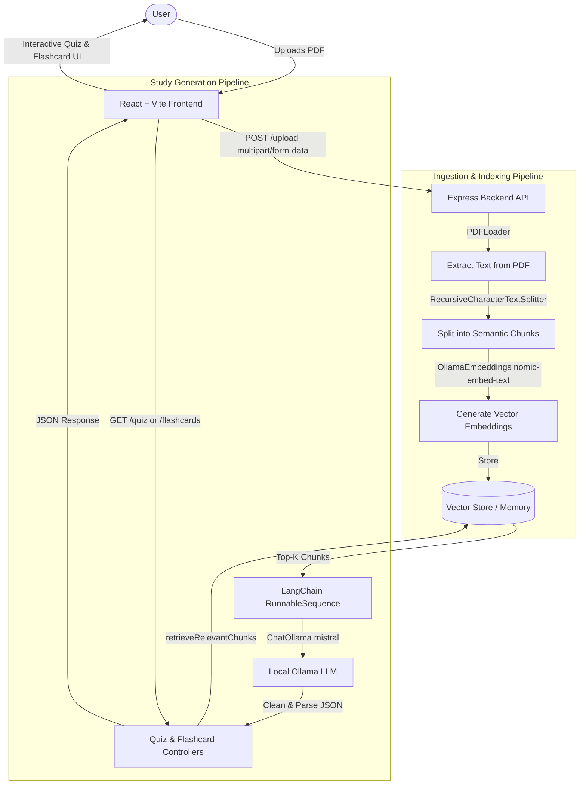

# PDF Prep 📚⚡

> **AI-Powered Study Assistant** — Transform your PDF textbooks, lecture slides, and research notes into interactive quizzes and flashcards using 100% local LLMs and Retrieval-Augmented Generation (RAG).

[](https://react.dev/)
[](https://vitejs.dev/)
[](https://tailwindcss.com/)
[](https://nodejs.org/)
[](https://expressjs.com/)
[](https://www.langchain.com/)
[](https://ollama.ai/)

---

## 🌟 Highlights

- 🔒 **100% Private & Local AI**: Powered by [Ollama](https://ollama.ai) (`mistral` & `nomic-embed-text`) via LangChain. Your documents and data never leave your local machine. No API keys or cloud subscriptions needed.
- 📄 **Smart PDF Ingestion**: Upload documents with instant feedback, automated text extraction with `PDFLoader`, and semantic chunking via `RecursiveCharacterTextSplitter`.
- 🧠 **Context-Aware Retrieval (RAG)**: Uses vector embeddings to retrieve relevant text chunks, guaranteeing that quizzes and flashcards are strictly grounded in your uploaded material.
- 📝 **Interactive Multiple Choice Quizzes**: Automatically generates 5-question multiple choice quizzes with zero-based index verification, real-time score calculation, answer explanations, and next-set generation.
- 🗂️ **Interactive Study Flashcards**: Study mode featuring 3D flip card animations, Deck mode & Grid overview, shuffle capabilities, and mastery status tracking (*Mastered* vs. *Still Learning*).
- 🎨 **Modern, Responsive UI**: Built with React 19, Tailwind CSS, Lucide Icons, smooth micro-interactions, and a clean minimalist aesthetic.

---

## 🏛️ Architecture & Data Flow



---

## 📁 Repository Structure

```text
pdf-prep/
├── client/                     # Frontend Application (React 19 + Vite + Tailwind)
│   ├── public/                 # Static assets
│   ├── src/
│   │   ├── api/
│   │   │   └── backend.js      # Fetch client for /upload, /quiz, /flashcards
│   │   ├── components/
│   │   │   ├── Flashcard.tsx   # 3D interactive flip card component
│   │   │   ├── Footer.tsx      # App footer
│   │   │   ├── Navbar.tsx      # Sticky navigation bar
│   │   │   ├── Quiz.jsx        # Quiz question card & option selector
│   │   │   └── UploadPDF.jsx   # Drag-and-drop document upload interface
│   │   ├── pages/
│   │   │   ├── FlashcardsPage.jsx # Full-featured flashcard study deck & grid
│   │   │   ├── QuizPage.jsx       # Multiple choice quiz & scoring view
│   │   │   └── UploadPage.jsx     # Main workspace & study mode switcher
│   │   ├── App.jsx             # Root React component
│   │   ├── index.css           # Global Tailwind CSS definitions
│   │   └── main.jsx            # React entry point
│   └── package.json
│
├── server/                     # Backend API (Express + LangChain + Ollama)
│   ├── config/
│   │   └── ollama.js           # Ollama LLM & Embeddings initialization
│   ├── controllers/
│   │   ├── flashcard.controller.js # Flashcard generation endpoint handler
│   │   ├── quiz.controller.js      # Quiz generation endpoint handler
│   │   └── upload.controller.js    # PDF file upload handler
│   ├── routes/
│   │   ├── flashcard.routes.js # GET /flashcards route
│   │   ├── quiz.routes.js      # GET /quiz route
│   │   └── upload.routes.js    # POST /upload route
│   ├── services/
│   │   ├── chunk.service.js    # Text splitting & chunking logic
│   │   ├── embedding.service.js# Embedding pipeline
│   │   ├── flashcard.service.js# LangChain flashcard generation chain
│   │   ├── pdf.service.js      # PDF loading and orchestration
│   │   ├── quiz.service.js     # LangChain quiz generation chain
│   │   └── rag.service.js      # In-memory vector store & similarity retrieval
│   ├── uploads/                # Temporary destination for uploaded files
│   ├── .env.example            # Environment variables template
│   ├── server.js               # Express server entry point
│   └── package.json
│
├── MIGRATION.md                # Migration guide from cloud APIs to local Ollama
└── README.md                   # Project documentation
```

---

## ⚡ Prerequisites

Before running the application, make sure you have the following installed:

1. **[Node.js](https://nodejs.org/)** (v18.0.0 or higher recommended) and `npm`.
2. **[Ollama](https://ollama.ai/)** installed and running on your system.

### Pull Required Ollama Models

Open your terminal and pull the LLM and embedding models:

```bash
# 1. Main Language Model (default is mistral)
ollama pull mistral

# 2. Embedding Model (for RAG vector search)
ollama pull nomic-embed-text
```

> **Alternative Models**: You can also use other Ollama models such as `neural-chat`, `llama2`, or `dolphin-mixtral`. Just update the model name in [server/config/ollama.js](file:///Users/sillymillie/Desktop/Code/projects/pdf-prep/server/config/ollama.js).

---

## 🚀 Getting Started

### 1. Start Ollama Service

Ensure the Ollama local daemon is running:

```bash
ollama serve
```

*(If Ollama is installed as a system service or desktop application, it may already be running in the background).*

---

### 2. Set Up the Backend Server

```bash
# Navigate to the server folder
cd server

# Install dependencies
npm install

# Create environment configuration
cp .env.example .env

# Start the server (runs on http://localhost:3000)
npm run dev
```

You can verify the backend and Ollama connectivity at any time:
```bash
curl http://localhost:3000/health
```

---

### 3. Set Up the Frontend Client

Open a new terminal window:

```bash
# Navigate to the client folder
cd client

# Install dependencies
npm install

# Start the Vite development server (runs on http://localhost:5173)
npm run dev
```

Open your browser and navigate to **`http://localhost:5173`**.

---

## 📡 API Reference

The Express backend listens on `http://localhost:3000` by default:

| Method | Endpoint | Description | Query / Body Parameters |
| :--- | :--- | :--- | :--- |
| `GET` | `/health` | Verifies server status & Ollama connectivity | None |
| `POST` | `/upload` | Ingests, parses, and embeds a PDF document | Form data: `pdf` (binary file) |
| `GET` | `/quiz` | Generates 5 multiple choice questions via RAG | `query` *(optional)*, e.g. `?query=neural networks` |
| `GET` | `/flashcards` | Generates 10 study flashcards via RAG | `query` *(optional)*, e.g. `?query=key definitions` |

### Sample Responses

#### `GET /health`
```json
{
  "status": "OK",
  "message": "Server is running and Ollama is connected",
  "ollamaConnected": true
}
```

#### `GET /quiz`
```json
{
  "questions": [
    {
      "question": "What is the primary function of backpropagation?",
      "options": [
        "Data normalization",
        "Gradient computation for weight updates",
        "Feature scaling",
        "Activation thresholding"
      ],
      "correctAnswer": 1
    }
  ]
}
```

#### `GET /flashcards`
```json
{
  "flashcards": [
    {
      "front": "What is overfitting?",
      "back": "A modeling error occurring when a function is too closely aligned to a specific dataset, failing to generalize to new data."
    }
  ]
}
```

---

## ⚙️ Configuration & Customization

### Environment Variables (`server/.env`)

| Variable | Default Value | Description |
| :--- | :--- | :--- |
| `OLLAMA_BASE_URL` | `http://localhost:11434` | URL of the local Ollama daemon |
| `CHROMA_URL` | `http://localhost:8000` | Optional Chroma DB service URL |
| `NODE_ENV` | `development` | Node execution environment |

### Customizing Models

Edit [server/config/ollama.js](file:///Users/sillymillie/Desktop/Code/projects/pdf-prep/server/config/ollama.js):

```javascript
export const llm = new ChatOllama({
  model: "mistral", // Switch to "llama2", "neural-chat", etc.
  baseUrl: process.env.OLLAMA_BASE_URL || "http://127.0.0.1:11434",
  temperature: 0.3,
});
```

### Tuning Chunk Size & Overlap

Edit [server/services/chunk.service.js](file:///Users/sillymillie/Desktop/Code/projects/pdf-prep/server/services/chunk.service.js):

```javascript
const splitter = new RecursiveCharacterTextSplitter({
  chunkSize: 1000,    // Max characters per chunk
  chunkOverlap: 200,  // Overlap between adjacent chunks
});
```

### Adjusting Retrieved Context

In [server/services/quiz.service.js](file:///Users/sillymillie/Desktop/Code/projects/pdf-prep/server/services/quiz.service.js) and [server/services/flashcard.service.js](file:///Users/sillymillie/Desktop/Code/projects/pdf-prep/server/services/flashcard.service.js), tweak `k` in `retrieveRelevantChunks(query, k)` to pass more or fewer chunks to the model context.

---

## 🛠️ Troubleshooting

- **`"Ollama is not connected"`**:
  - Check whether Ollama is active: `curl http://localhost:11434/api/tags`.
  - If stopped, start it with `ollama serve`.
  - Confirm `OLLAMA_BASE_URL` in `server/.env` matches your Ollama port.

- **`"No relevant content found in vector store"`**:
  - Ensure you have uploaded a PDF document first.
  - Check the server console logs to verify chunks were generated and indexed.

- **Slow generation or timeout**:
  - Mistral and Llama2 require decent CPU/GPU resources. If generation takes too long, test with a smaller model like `phi3:mini` or `tinyllama`.
  - Reduce the retrieval context (`k`) or decrease the `chunkSize`.

---

## 👤 Author

Developed by **[Smriti Singh](https://smriitiisiingh.netlify.app/)**  
GitHub: [@smritisingh21](https://github.com/smritisingh21) • Repository: [pdf-prep](https://github.com/smritisingh21/pdf-prep)

---

## 📄 License

This project is open-source and available under the [ISC License](file:///Users/sillymillie/Desktop/Code/projects/pdf-prep/server/package.json).
